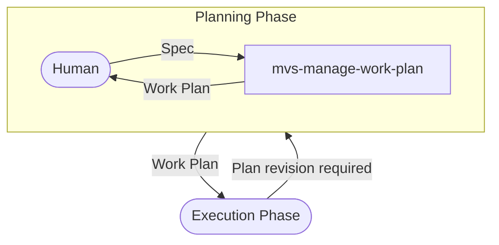
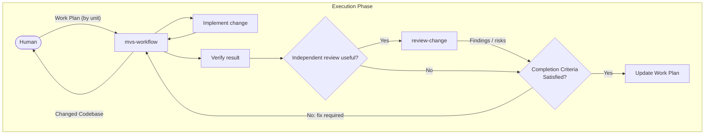

# marvis-dev

This document shows how the `marvis-dev` plugin is organized. Read the linked skill files and manifests for the full instructions and settings.

## Purpose

This repository contains reusable parts for development tools. At present, it contains one plugin: `marvis-dev`.

- Keep skill instructions independent of Codex, Claude Code, Cursor, GitHub Copilot, and other agent tools.
- Keep settings for each tool in separate manifests and marketplace files.
- Use a layout that can adapt as agent tools change.

See [AGENTS.md](../AGENTS.md) for the repository rules.

## Components

### Skills

| Skill | Purpose |
| --- | --- |
| [`mvs-manage-work-plan`](../plugins/marvis-dev/skills/mvs-manage-work-plan/SKILL.md) | Create and update a work plan with goals, limits, tasks, and completion criteria. |
| [`mvs-workflow`](../plugins/marvis-dev/skills/mvs-workflow/SKILL.md) | When and to whom to make a request, and what to do next based on the outcome. |

## Architecture & Workflow

This diagram shows how agents can use the skills and their output. The arrows show information flow. They do not start a skill automatically.

Planning Phase:

Execution Phase:

