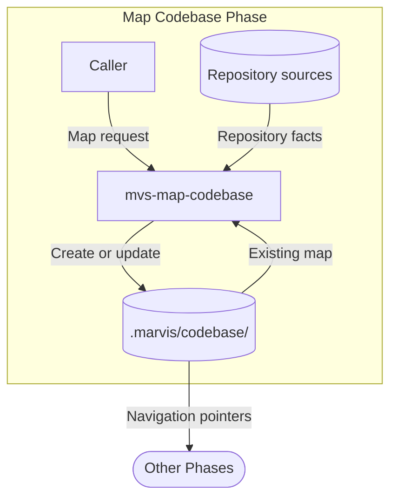
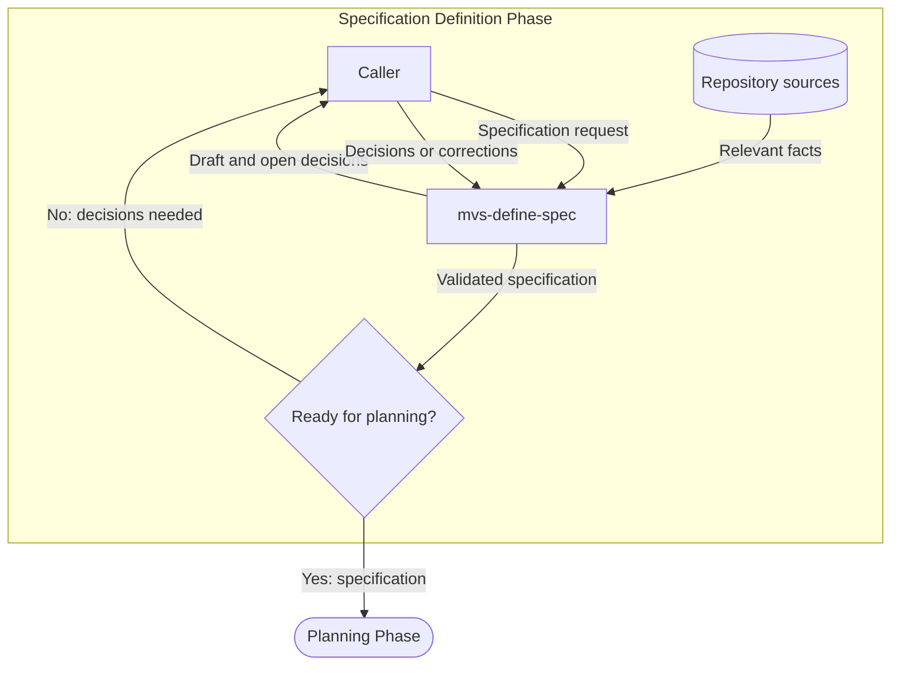
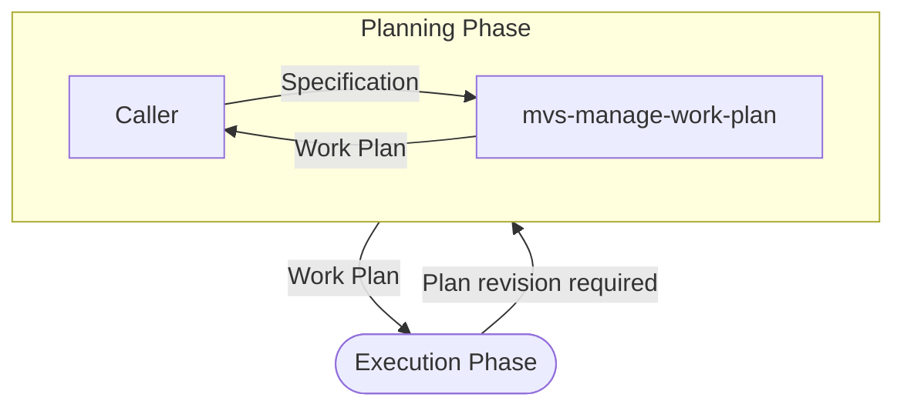
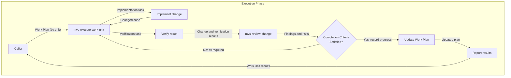

# marvis-dev

Read the linked skill files for their full instructions.

## Purpose

The `marvis-dev` plugin contains reusable skills for development work.

- Keep skill instructions independent of Codex, Claude Code, Cursor, GitHub Copilot, and other agent tools.
- Keep settings for each tool in separate manifests and marketplace files.
- Use a layout that can adapt as agent tools change.

The other `mvs-*` skills use `.marvis/codebase/README.md` as an entry point when they need repository context. They open relevant topics as needed and check important findings against primary sources. If the map is unavailable, they inspect primary sources directly. They report concrete map problems in their handoffs without changing the map.

The map uses short selection conditions to help readers choose the next source. It can point to feature and module entry points, verification procedures, and repository-specific tools when those pointers reduce search.

## Components

### Skills

| Skill | Purpose |
| --- | --- |
| [`mvs-map-codebase`](skills/mvs-map-codebase/SKILL.md) | Maintain a codebase map in `.marvis/codebase/`. |
| [`mvs-define-spec`](skills/mvs-define-spec/SKILL.md) | Define or revise a specification when requested. |
| [`mvs-manage-work-plan`](skills/mvs-manage-work-plan/SKILL.md) | Create and update a work plan with goals, limits, tasks, and completion criteria. |
| [`mvs-review-change`](skills/mvs-review-change/SKILL.md) | Review changes against requirements and test results. |
| [`mvs-execute-work-unit`](skills/mvs-execute-work-unit/SKILL.md) | Implement and verify one Work Unit. |

## Workflow

These diagrams show how agents can use the skills and their output. Subgraphs mark phases. Rounded nodes refer to other phases. Cylinders show stored repository content. Diamonds show decisions. Rectangles show callers, skills, and actions. Arrows show information transfer or the next action, as stated by their labels. An arrow does not start a skill automatically.

### Map Codebase Phase

### Specification Definition Phase

### Planning Phase

### Execution Phase

Execute by unit

- The executor may perform or delegate implementation, verification, and review. Review uses `mvs-review-change` in either case.
